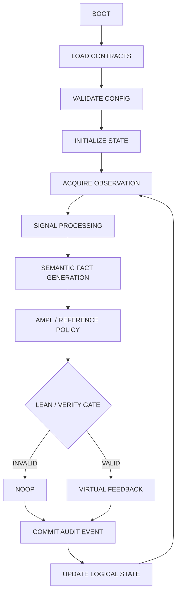
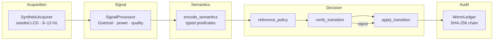
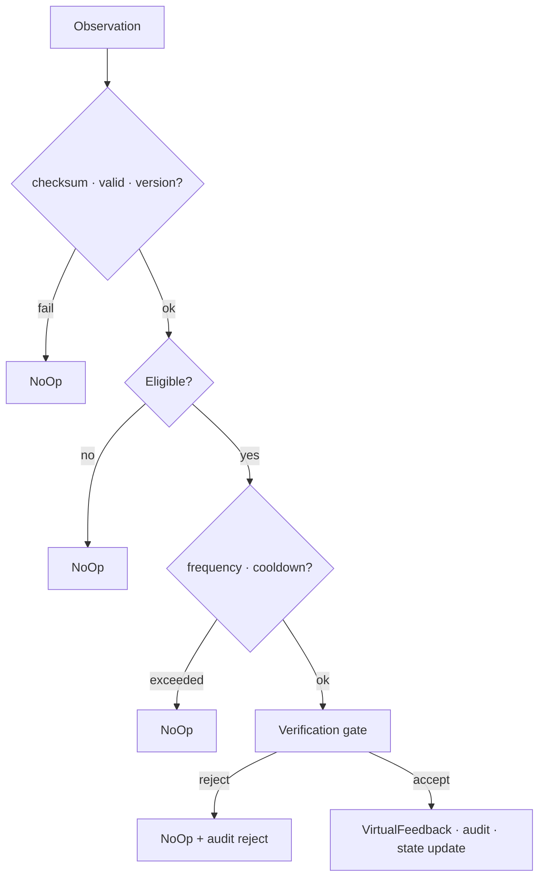

# ALPHA-Ω

**Sovereign Semantic Closed-Loop Feedback Engine**

[](https://www.gnu.org/licenses/agpl-3.0)
[](https://www.rust-lang.org/)
[](https://github.com/AHMADALIPARR/alpha-omega)
[](https://github.com/AHMADALIPARR/alpha-omega)
[](https://github.com/AHMADALIPARR/alpha-omega)
[](https://github.com/AHMADALIPARR/alpha-omega)

Deterministic, formally constrained, semantics-driven closed-loop feedback simulation inspired by publicly documented alpha-band neural feedback research and DARPA-funded closed-loop neurotechnology principles.

> **This is an independent engineering implementation.** It does not reproduce proprietary DARPA code or undisclosed algorithms. Physical neural stimulation is explicitly excluded. All feedback actuators are simulated (virtual events only).

---

## Control loop



---

## Architecture



| Subsystem | Role | Status |
|-----------|------|--------|
| **Acquisition** | Seeded synthetic alpha-band, drop detection, EOS | ✅ Running |
| **Signal** | Windowed spectral power, quality metrics | ✅ Running |
| **Semantics** | Typed facts + provenance digests | ✅ Running |
| **Policy** | Reference π(S) with cooldown & frequency bound | ✅ Running |
| **Verification gate** | Fail-closed; invalid → NoOp | ✅ Running |
| **Executor** | Deterministic F(S,O,A) | ✅ Running |
| **Ledger** | Append-only SHA-256 hash chain | ✅ Running |
| AMPL contracts | Mixed-integer model | 📄 Spec only (solver not in env) |
| Lean 4 | Safety obligations | 📄 Spec only (Lean not in env) |
| Elixir/OTP | Supervision tree | ⏸ Blocked (toolchain absent) |
| Modula-2 | Alternate numerics | ⏸ Blocked (toolchain absent) |

---

## Quick start

```bash
git clone https://github.com/AHMADALIPARR/alpha-omega.git
cd alpha-omega
cargo build --release

# Some environments mount the target dir noexec — copy if needed:
cp target/release/alpha-sim /tmp/alpha-sim && chmod 755 /tmp/alpha-sim
/tmp/alpha-sim --cycles 200 --seed 42
/tmp/alpha-sim --cycles 80 --seed 42 -v

cargo test --release
make sim
```

### Example output

```
=== ALPHA-Ω Closed-Loop Simulation ===
protocol_version=1  seed=42  cycles=100  rate=256Hz

LEDGER: chain integrity OK (100 events)

=== Summary ===
processed_windows : 100
feedback_actions  : 3
noop_actions      : 97
rejections        : 0
ledger_events     : 100
final_clock       : 100
final_head_hash   : 93fd3947...
```

Same seed → identical ledger digests (deterministic replay).

---

## Invariants



Enforced in code:

- `¬Eligible(S) ⇒ A = NoOp`
- Invalid / checksum-failed observations cannot authorize feedback
- Feedback count ≤ `MAX_FEEDBACK_WINDOW` (3)
- Cooldown after each feedback action
- Logical clock advances on every committed step
- Ledger records every decision (accepted or rejected)
- No physical stimulation interfaces

---

## Repository layout

```
alpha-omega/
├── src/
│   ├── lib.rs          # acquisition, signal, semantics, policy, verify, transition, ledger
│   ├── main.rs         # alpha-sim driver
│   └── sha256.rs       # FIPS 180-4 SHA-256 (no deps)
├── contracts/
│   └── alpha_feedback.mod
├── semantics/
│   └── predicates.dl
├── verification/
│   └── AlphaSafety.lean
├── Cargo.toml
├── Makefile
├── LICENSE             # AGPL-3.0
└── README.md
```

---

## Design constraints

| Constraint | How met |
|------------|---------|
| No Python / Node / JS runtime | Pure Rust `std` only |
| No external crates | Hand-rolled SHA-256; no crates.io |
| No pseudocode in executable path | Full implementations |
| No `sorry` / `admit` in Lean | Open obligations documented only |
| Fail-closed verification | Gate → NoOp on any rejection |
| Deterministic | Seeded LCG; fixed arithmetic policies |
| Auditable | SHA-256 hash-chained event log |

---

## License

[GNU Affero General Public License v3.0](LICENSE)

Copyright (C) 2025–2026 ALPHA-Ω contributors.

If you run a modified version of this software on a server and let users interact with it, the AGPL requires you to provide them the corresponding source.
