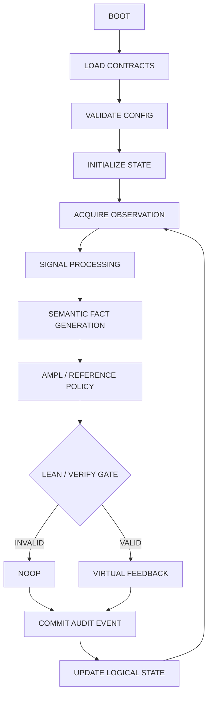
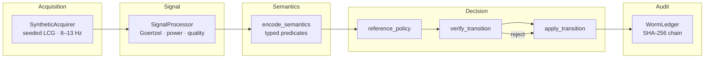
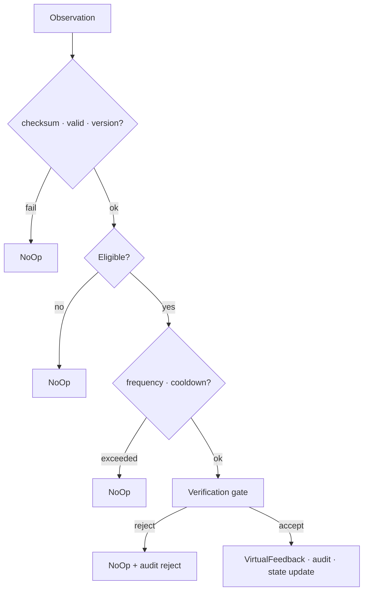

# ALPHA-Ω

**Sovereign Semantic Closed-Loop Feedback Engine**

[](https://www.gnu.org/licenses/agpl-3.0)
[](https://www.rust-lang.org/)
[](https://github.com/AHMADALIPARR/alpha-omega)
[](https://github.com/AHMADALIPARR/alpha-omega)
[](https://github.com/AHMADALIPARR/alpha-omega)
[](https://github.com/AHMADALIPARR/alpha-omega)

Deterministic, formally constrained, semantics-driven closed-loop feedback simulation inspired by publicly documented alpha-band neural feedback research and DARPA-funded closed-loop neurotechnology principles.

> **This is an independent engineering implementation.** It does not reproduce proprietary DARPA code or undisclosed algorithms. Physical neural stimulation is explicitly excluded. All feedback actuators are simulated (virtual events only).

---

## Control loop



---

## Architecture



| Subsystem | Role | Status |
|-----------|------|--------|
| **Acquisition** | Seeded synthetic alpha-band, drop detection, EOS | ✅ Running |
| **Signal** | Windowed spectral power, quality metrics | ✅ Running |
| **Semantics** | Typed facts + provenance digests | ✅ Running |
| **Policy** | Reference π(S) with cooldown & frequency bound | ✅ Running |
| **Verification gate** | Fail-closed; invalid → NoOp | ✅ Running |
| **Executor** | Deterministic F(S,O,A) | ✅ Running |
| **Ledger** | Append-only SHA-256 hash chain | ✅ Running |
| AMPL contracts | Mixed-integer model | ✅ Solved (GLPK; engine trace feasible) |
| Lean 4 | Safety obligations | ✅ Proven (5/5 obligations, no sorry) |
| Elixir/OTP | Supervision tree | ✅ Running (OTP 25 / Elixir 1.18) |
| Modula-2 | Alternate numerics | ✅ Running (cross-checked vs Rust) |
| Datalog | Semantic predicate contract | ✅ Conformance-tested (576 scenarios) |

---

## Quick start

```bash
git clone https://github.com/AHMADALIPARR/alpha-omega.git
cd alpha-omega
cargo build --release

# Some environments mount the target dir noexec — copy if needed:
cp target/release/alpha-sim /tmp/alpha-sim && chmod 755 /tmp/alpha-sim
/tmp/alpha-sim --cycles 200 --seed 42
/tmp/alpha-sim --cycles 80 --seed 42 -v

cargo test --release
make sim
make bench   # in-process benchmark harness, chain verified per run
make demo    # full reproducible demonstration: every layer, PASS/FAIL/SKIP

# Elixir/OTP supervision demo (OTP 25 + Elixir, zero deps):
cd elixir && mix test && mix run demo.exs

# Modula-2 alternate numerics (gm2):
cd modula2 && gm2 -O2 -o alpha_numerics AlphaNumerics.mod && ./alpha_numerics
```

### Example output

```
=== ALPHA-Ω Closed-Loop Simulation ===
protocol_version=1  seed=42  cycles=100  rate=256Hz

LEDGER: chain integrity OK (100 events)

=== Summary ===
processed_windows : 100
feedback_actions  : 3
noop_actions      : 97
rejections        : 0
ledger_events     : 100
final_clock       : 100
final_head_hash   : 447a4b918ddffedabe1ec82d75f207c437b82a20ce19b3bdf38c4e5615c48055
dropped_samples   : 0
```

Same seed → identical ledger digests (deterministic replay).

> The counts above are the verified output of the current tree
> (`docs/demo-golden.txt` pins them for `make demo`). An earlier
> edition of this example showed a head hash beginning `93fd3947…`,
> produced by a ledger serialization that was never published; the
> counts were identical.

---

## Invariants



Enforced in code:

- `¬Eligible(S) ⇒ A = NoOp`
- Invalid / checksum-failed observations cannot authorize feedback
- Feedback count ≤ `MAX_FEEDBACK_WINDOW` (3)
- Cooldown after each feedback action
- Logical clock advances on every committed step
- Ledger records every decision (accepted or rejected)
- No physical stimulation interfaces

---

## Verification layers

Every layer is executed, not asserted (`make demo` replays all of them):

- **Rust tests (10)** — SHA-256 FIPS vectors; the Lean obligations as
  runtime tests; Datalog conformance; deterministic replay.
- **Lean 4** — `verification/AlphaSafety.lean`: a `transition`
  mirroring the engine, with all five safety obligations proven.
  No `sorry` / `admit`; axiom audit shows at most `propext`.
- **Datalog** — `semantics/predicates.dl` rules transcribed and
  checked against `encode_semantics` over a 576-scenario grid.
- **AMPL** — `contracts/alpha_feedback.mod`, solved with GLPK via
  the labeled GMPL translation in `contracts/` (data generated from
  the canonical trace). The engine's own action assignment is
  independently verified feasible against every constraint;
  see `contracts/glpk_run.log`.
- **Modula-2** — `modula2/AlphaNumerics.mod` reimplements the
  Goertzel kernel and reproduces the Rust fixed-point power exactly
  (100000 on the reference window).
- **Elixir/OTP** — `elixir/`: the supervisor runs the engine on a
  Port, verifies determinism across runs, and recovers from the
  runner being killed (bounded restarts, bounded run log).
- **Benchmark** — `src/bin/alpha-bench.rs`; measured table in
  `docs/benchmark-results.txt` (timings are the measuring machine's;
  the seed-42 head hashes are machine-independent).

---

## Repository layout

```
alpha-omega/
├── src/
│   ├── lib.rs               # module root
│   ├── core_impl.rs         # include root for the engine bodies
│   ├── domain_body.rs       # domain types, protocol constants
│   ├── acq_sig_body.rs      # synthetic acquisition, Goertzel signal processing
│   ├── policy_body.rs       # semantics, policy, verification gate, transition
│   ├── ledger_loop_body.rs  # WORM ledger, closed-loop step, engine tests
│   ├── main.rs              # alpha-sim driver
│   ├── sha256.rs            # FIPS 180-4 SHA-256 (no deps)
│   └── bin/alpha-bench.rs   # benchmark harness
├── elixir/                  # OTP supervision tree (mix project, zero deps)
│   ├── lib/alpha_omega/     # application, supervisor children, Port runner, parser
│   ├── test/                # ExUnit: parser + runner (8 tests)
│   └── demo.exs             # supervised run, replay, kill + restart
├── modula2/
│   └── AlphaNumerics.mod    # alternate Goertzel numerics (gm2)
├── contracts/
│   ├── alpha_feedback.mod       # AMPL model (canonical)
│   ├── alpha_feedback_gmpl.mod  # GMPL translation for GLPK (abs linearized)
│   ├── alpha_feedback.dat       # data instance from the canonical trace
│   └── glpk_run.log             # solver result + feasibility check
├── semantics/
│   └── predicates.dl
├── verification/
│   └── AlphaSafety.lean     # obligations, all proven
├── docs/
│   ├── SOURCE.md
│   ├── benchmark-results.txt
│   └── demo-golden.txt      # canonical seed-42 summary, pinned for make demo
├── scripts/
│   ├── demo.sh              # reproducible demonstration (make demo)
│   └── restore_lib.sh       # base64 fragment restore for src/lib.rs
├── Cargo.toml
├── Makefile
├── LICENSE                  # AGPL-3.0
└── README.md
```

---

## Design constraints

| Constraint | How met |
|------------|---------|
| No Python / Node / JS runtime | Pure Rust `std` only |
| No external crates | Hand-rolled SHA-256; no crates.io |
| No pseudocode in executable path | Full implementations |
| No `sorry` / `admit` in Lean | All five obligations proven; axiom audit: at most `propext` |
| Fail-closed verification | Gate → NoOp on any rejection |
| Deterministic | Seeded LCG; fixed arithmetic policies |
| Auditable | SHA-256 hash-chained event log |

---

## License

[GNU Affero General Public License v3.0](LICENSE)

Copyright (C) 2025–2026 ALPHA-Ω contributors.

If you run a modified version of this software on a server and let users interact with it, the AGPL requires you to provide them the corresponding source.
